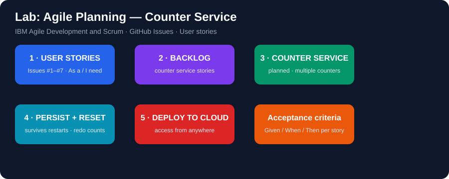
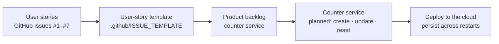

<div align="center">

# 🧮 Lab: Agile Planning

**This repository contains the lab for agile planning**


*IBM Agile Development and Scrum · Coursera · GitHub Issues · User Stories*

</div>

---

## 🎯 What this does

The agile-planning lab for the IBM Agile Development and Scrum course: practise writing user stories and building a product backlog — here for a **counter service** that keeps track of how many times something has been done.

> **The rule:** every piece of work starts as a user story, with acceptance criteria, before any code is written.

This repository currently holds the lab plan: the README and the user-story backlog tracked as GitHub Issues. There is no counter service code in this repo yet — the lab is the planning itself.

## 🖼️ Architecture





📸 **Screenshots:** the architecture diagram above is the visual reference for this repo. No screenshots exist yet — a real screenshot of the backlog board can be added later at `docs/screenshots/backlog.png`. No fake screenshots are included.

## 📋 User stories (the backlog)

All 7 open issues, written in the `As a … I need … So that …` format with Gherkin acceptance criteria. Each issue uses the user-story template in `.github/ISSUE_TEMPLATE/user-story.md`.

| Issue | Story | Who |
|------:|-------|-----|
| [#1](https://github.com/abdullacaad/lab-agile-planning/issues/1) | Need a service that has a counter | User |
| [#2](https://github.com/abdullacaad/lab-agile-planning/issues/2) | Must allow multiple counters | User |
| [#3](https://github.com/abdullacaad/lab-agile-planning/issues/3) | Must persist counter across restarts | Service provider |
| [#4](https://github.com/abdullacaad/lab-agile-planning/issues/4) | Counters can be reset | System administrator |
| [#5](https://github.com/abdullacaad/lab-agile-planning/issues/5) | Deploy service to the cloud | Service provider |
| [#6](https://github.com/abdullacaad/lab-agile-planning/issues/6) | Need the ability to remove a counter | User |
| [#7](https://github.com/abdullacaad/lab-agile-planning/issues/7) | Need the ability to update a counter to a new value | User |

## ⚡ How to work on it

There is no code to run yet. Work starts from the backlog:

1. Pick an open issue from the table above.
2. Read its acceptance criteria (Gherkin `Given / When / Then`).
3. Build that story — or, for this lab, refine the story and its acceptance criteria.
4. Close the issue when the acceptance criteria are met.

New stories are filed with **Issues → New issue → User Story**, which opens the template with the `As a / I need / So that`, Details and Assumptions, and Acceptance Criteria sections already laid out.

## 📂 Project layout

```
.
├── .github/ISSUE_TEMPLATE/     # user-story.md — template for new stories
├── docs/
│   └── architecture.svg        # stories → backlog → counter service
├── LICENSE                     # MIT
└── README.md
```

## 📄 License

MIT — see [LICENSE](LICENSE).
